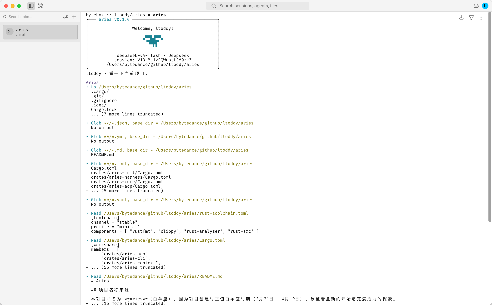
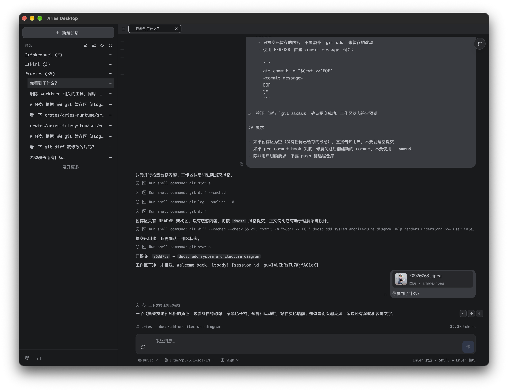

# Aries

## 项目名称来源

本项目命名为 **Aries**（白羊座），因为项目创建时正值白羊座时期（3月21日 - 4月19日）。象征着全新的开始与充满活力的探索。

## Apps

### Aries CLI (`aries`)

终端 AI 助手，通过 Agent Client Protocol 与各类 IDE 集成，支持模型管理、网络访问等功能。

### Aries Desktop (`aries-desktop`)

原生 macOS 终端模拟器，内置 AI 能力。基于 GPUI 构建，提供高性能的原生体验。

## Rust toolchain

本项目使用 **nightly** 工具链（Rust 2024 edition）。

## 安装

目前仅支持源码安装，还未发布到 crates.io 上。

### Aries CLI

> just install-cli

或:

> cargo install --path apps/aries-cli --force --locked

### Aries Desktop

仅支持 macOS。

源码安装:

> cargo install --path apps/aries-desktop --force --locked

DMG 安装:

> just desktop-dmg
>
> open target/bundle/Aries-Desktop-*.dmg

## 使用

### 首次使用:

执行: `aries setup`

后续增加或者删除模型, 使用 `aries model add`, `aries model rm` 命令。

切换模型使用: `aries model default`。

查看当前所有模型: `aries model list`.

## 在支持 Agent Client Protocol 的 IDE 中使用

> 详见 [docs/acp.md](docs/acp.md)

## 支持访问网络

> 详见 [docs/web-tool.md](docs/web-tool.md)

## 评测

评测相关脚本位于 [scripts](scripts/) 目录下，目前包含 SWE-bench 评测等工具。
